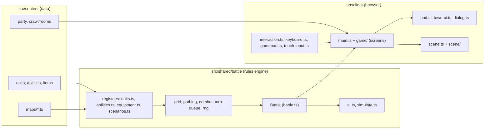
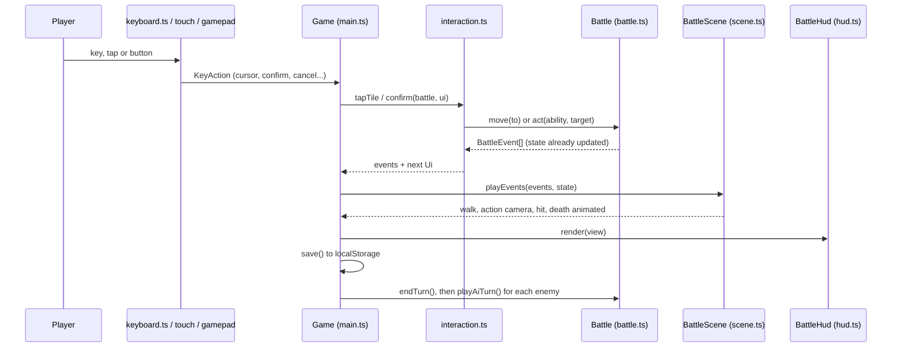
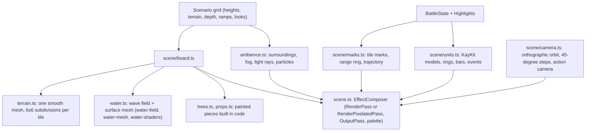

# Architecture

Dungeon Tactics is a static single-page game: TypeScript compiled by Vite, rendered with Three.js, served as plain files. There is no server. This document describes how the code is split, how a turn flows through it, and how it is tested. Every claim points to the file that implements it.

## Layers

| Layer | Folder | What it may import |
|---|---|---|
| Content | `src/content` | only types (`import type`) and pure helpers such as `parseGrid` and `withRamps` from `src/shared/battle/grid.ts` ([`src/content/CLAUDE.md`](src/content/CLAUDE.md)) |
| Rules engine | `src/shared/battle` | content (to build its registries) and nothing from `src/client`; no DOM, no Three.js |
| Client | `src/client` | everything above, plus Three.js and the DOM |

- **Content is typed data.** Classes, abilities, items and maps live in `src/content` as TypeScript arrays (`UNIT_LIST`, `ABILITY_LIST`, `ITEM_LIST`, one file per map in `src/content/maps/`). The engine turns them into lookup tables (`UNIT_DEFS`, `ABILITIES`, `ITEMS`, `MAPS`/`SCENARIOS` in `src/shared/battle/scenarios.ts`). The party roster and the dungeon crawl tables also live in `src/content`; the party's types and rules are in the client (`src/client/group.ts`), which is why content imports types from both layers.
- **Abilities are general stats, not special cases.** An ability is range, damage, accuracy, area, push and charge (`A()` in `src/content/abilities.ts`); the combat code applies them the same way to every target.
- **The rules engine is pure.** `grid.ts` (heights, terrain, water depth), `pathing.ts` (reach, jump, leaps, line of sight, shot path), `combat.ts` (hit chance, damage, push, falls, counters, forecast) and `turn-queue.ts` are functions over plain data. The one class is `Battle` (`battle.ts`), because the state, the undo history and the save have a lifecycle.
- **The client draws and asks.** `main.ts` owns the game loop; `scene.ts` only renders what it is given and knows no rules (its header comment says so); `hud.ts` builds the DOM interface from the components in `dialog.ts`.

## A turn, step by step

1. **Input.** `keyboard.ts` turns a `KeyboardEvent` into a `KeyAction` (`keyAction`) and a screen direction into a grid step that follows the camera yaw (`gridStep`). `gamepad.ts` maps buttons to the same `KeyAction`s; `touch-input.ts` turns taps, drags and pinches into tile picks, pans and zooms.
2. **Interaction.** `interaction.ts` holds the battle UI state without DOM or Three.js: the selected mode, the pending tile and the highlights to draw (`highlights`). `confirm` calls `Battle.move` or `Battle.act` (`src/client/interaction.ts`).
3. **Rules.** `Battle.move` checks the path against `reach()`, applies counters and spends movement; `Battle.act` validates the target with `preview()` and resolves the ability, or registers a charge. Both return `BattleEvent[]` (`src/shared/battle/types.ts`): `move`, `attack`, `charge`, `hit`, `miss`, `heal`, `push`, `bump`, `fall`, `spike`, `die`, `fizzle`. The state is already final when the events come out.
4. **Animation.** `Game.animate` hands the events to `BattleScene.playEvents`, which plays them on the units one by one (`scene/unit-events.ts`), including the action camera on a strike (`scene/camera.ts`, `actionCam`).
5. **HUD and save.** The HUD redraws from a view of the battle; `Game.save` writes `Battle.save()` to `localStorage` (`src/client/main.ts`).
6. **End of turn and enemies.** `Battle.endTurn` applies end-of-turn spikes, fires any charges that come due and starts the next turn. While the actor is an enemy, `Game.runEnemies` calls `playAiTurn` (`src/shared/battle/ai.ts`) and animates its events with a pause so the player can follow.

### Turn order

`turn-queue.ts` implements an FFT-style CT queue: every unit gains its speed in CT per tick and acts on reaching `TURN_THRESHOLD` (100). Ending a turn costs 100 CT after moving and acting, 80 after one of the two and 60 after neither (`turnCt`), so waiting brings the next turn sooner. Charged abilities sit in `BattleState.charges` and fire when their ticks run out, possibly before the next unit acts. `previewOrder` feeds the turn list in the HUD.

### AI

`ai.ts` is a greedy one-turn planner: `chooseTurn` scores every reachable tile and ability by expected damage, kills, height, cover, threat from enemies and the objective to protect, with fixed weights (`W`) and no dice, so the same situation always gives the same plan. It measures distance on foot (`walkMap`), including water cost and jump.

## Determinism, save and undo

- **Seeded RNG in the state.** `rng.ts` is mulberry32 written as a pure function: `nextRng(state)` returns the value and the next state, and that state is the `rng` field of `BattleState`. The rules never call `Math.random` (a grep of `src/shared` and `src/content` outside the `fft/` study finds none). Rolls happen in a fixed order per target: hit, then damage. The only random number is the seed a new battle gets in the client (`newBattle` in `src/client/game/boot.ts`).
- **Plain JSON state.** `BattleState` holds units, the turn, charges, outcome and the RNG state; maps and definitions stay outside and are looked up by id. That makes `clone()`, `save()` and the simulator trivial.
- **Undo never rolls back the dice.** `Battle` keeps a history of the current turn's frames without the RNG field (`endTurn` clears it). Undoing a move is free; undoing an action that rolled dice uses up one of the `UNDO_LIMIT` (3) paid undos of the battle, and the RNG state is kept, so retrying an attack does not repeat the same roll (`undo()` in `battle.ts`). A move that triggered a counter-attack clears the history.
- **Saves are a trust boundary.** `Battle.load` and `parseBattleState` rebuild the state field by field and return `null` on anything unexpected: unknown scenario or unit, a unit outside the map or on a blocked tile, duplicate ids, out-of-range HP or CT. The other browser saves (`dt:*`: party, equipment, chest, expedition) follow the same pattern with their own `parse*` functions (`group.ts`, `chest.ts`, `parseExpedition` in `src/shared/crawl/expedition.ts`).

## Rendering pipeline

- **Terrain.** Open maps use a single smooth mesh (`src/client/terrain.ts`): each tile is subdivided 6x6 (`SUB`), flat in the middle where units and markers sit, sloping in the outer third, and the mesh continues a few tiles past the board, fading to black (the ring and the river that continues off the map are in `terrain-outer.ts`). It is drawing only; the rules read the tile heights from `grid.ts`. Crypt maps keep the KayKit block pieces. Textures are painted by `scripts/assets/paint-textures.py` (periodic noise mapped to a few tones plus brush strokes), not photos.
- **Water.** `src/client/water-field.ts` runs a damped wave equation on a fine height field on the CPU, and `water.ts` feeds it from the units. Units entering, walking, jumping or being pushed into water disturb it; waves spread and reflect off the banks; the river current drags the field. The field sleeps when the water calms. Neighbouring tiles of the same height share the field, so the surface is continuous; colour is banded by depth. The water heights used in the drawing are a pure module (`water-levels.ts`) so they can be tested.
- **Trees and props.** `src/client/trees.ts` (parts in `tree-parts.ts`) and `props.ts` assemble broadleaf trees, pines, dead trees, bushes, crates and barrels from code with vertex-painted colour and one material (`painted.ts`), one draw call per piece. Crowns, and ground or walls standing above a unit's floor, that would hide a unit get cut out from the camera's point of view (`board.see.update` in `scene.ts`, `scene/see-through.ts`).
- **Ambience.** `src/client/ambience.ts` adds the ground and forest around the board, fog, light rays, torches and particles per map mood, without post-processing.
- **Marks.** `scene/marks.ts` draws the move and range tiles, the blocked-shot tiles, the dotted ring of the longest ability, the shot trajectory and the cursor.
- **Camera.** `scene/camera.ts` is an orthographic camera orbiting a focus point at a fixed tilt, rotating in 45° steps (8 angles), sliding to whoever acts and switching to an action camera on strikes.
- **Frame.** `BattleScene.frame` advances the battle clock (`scene/timeline.ts`, which the speed-up button scales), updates camera, marks, units, board water and ambience, and renders through an `EffectComposer`. Plain 3D is the default (`defaultPixel` in `pixel-settings.ts`): the normal `RenderPass` runs and the `RenderPixelatedPass` is enabled only when the player turns pixel art on in Options.

## Testing

| Check | Command | What it covers |
|---|---|---|
| Lint and format | `npm run lint` | Biome over the whole repository |
| Types | `npm run typecheck` | the client, the tests and `scripts/` (two `tsconfig` files) |
| Unit tests | `npx vitest run` | Test files for: the rules engine (`battle-*.test.ts`, FFT formulas), content integrity (`content.test.ts`, `scenario-maps.test.ts`), dungeon rooms and the expedition, and the pure client functions (input mapping, interaction, HUD forecast and layout, markers, water levels, save parsers) |
| Coverage | `npm run coverage` | V8 coverage of `src/`; the `fft/` study and `types.ts` are excluded (`vite.config.ts`) |
| Browser smoke test | `npx vite build && npm run smoke` | serves `dist/` with `vite preview` and opens the title (fresh and with a save), the town, the expedition map and its first room, the Ash Wood battle and a crawl boss room in headless Chrome; fails on a missing screen, a console error or a failed request (`scripts/smoke-game.mjs`) |
| AI vs AI | `npm run sim -- <scenario> <seeds>` | optional balance tool: win rate, turns and survivors over many seeds (`scripts/battle-sim.ts`, `src/shared/battle/simulate.ts`) |

The tests never import Three.js or the DOM (`tests/CLAUDE.md`): code that needs testing is split into a pure function next to the module that draws it (for example `markers.ts`, `water-levels.ts`, `interaction.ts`). A logic bug fix comes with a test that fails without the fix. Content tests make data mistakes fail the build: unique ids, every reference resolvable, full map grids, free spawn tiles, ramps that rise exactly one level.

GitHub Actions (`.github/workflows/ci.yml`) runs lint, types, tests with coverage, the build and the smoke test (on Playwright's Chromium with software WebGL) on every pull request and every push to `master`.
