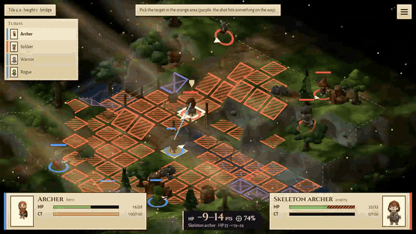
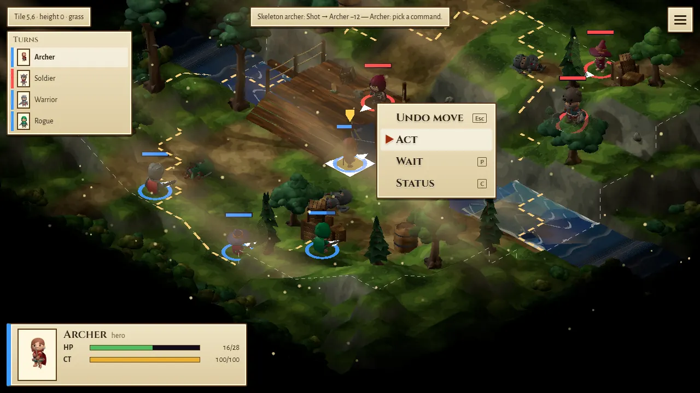
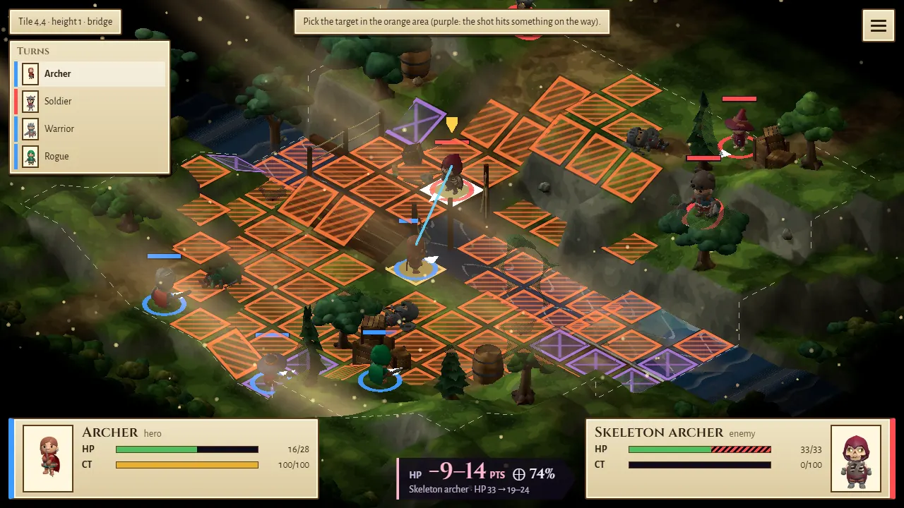
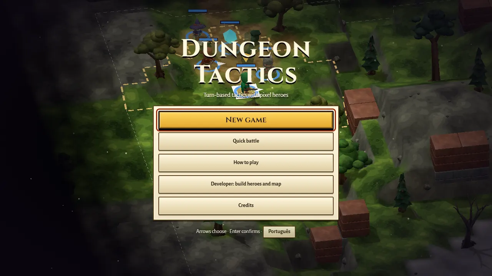
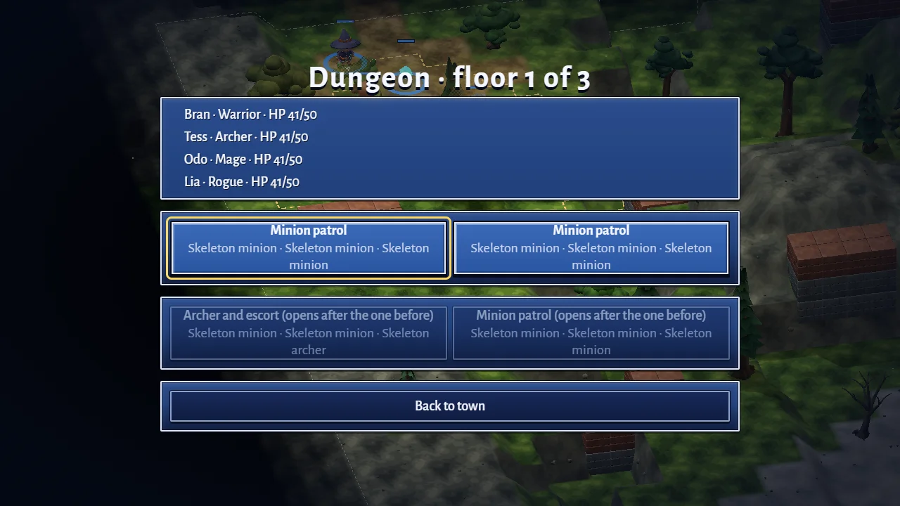

# Dungeon Tactics

[](https://github.com/fernandorff/dungeon-tactics/actions/workflows/ci.yml)
[](LICENSE)




**A turn-based tactics game for the browser in the tradition of Final Fantasy Tactics and Tactics Ogre: height, facing, charged spells and dungeon descents on painted 3D maps.**

**Play it:** https://dungeon-tactics.fernandorffdev.com (desktop browser; keyboard, mouse or gamepad)

Nothing is copied from the originals: rules, art direction, text and code are our own; models, sounds and music are free-licensed assets.

## Features

| | |
|---|---|
|  |  |
|  |  |

- **Dungeon descents:** a town to prepare the party, then an expedition map of short procedural rooms floor by floor, each room a battle that carries the party's life into the next, down to a 2x2 boss.
- **Tactical rules in the FFT tradition:** a CT turn queue, charged spells, per-class jump and leaps, height that adds range and hit chance, facing, push and fall damage, counters, deep and shallow water, spike traps and 2x2 bosses.
- **Move, act, keep moving:** units spend a movement budget around their action, and a move can be undone while nothing has been revealed.
- **Readable combat:** a Tactics Ogre-style forecast with hit chance and HP before and after, shot trajectories that stop at the first obstacle, a range ring for the longest skill and an action camera.
- **Party management:** recruit at the tavern, change classes (including the lancer), equip items bought at the shop.
- **Painted maps:** smooth terrain with painted textures, procedural trees and props, wave-field water with currents and waterfalls, fog and light per map, 8 camera angles, optional pixel-art rendering.
- Keyboard, mouse and gamepad; English and Portuguese.

## Technical highlights

- **Pure, deterministic rules engine.** `src/shared/battle` has no DOM or Three.js. The battle state is plain JSON with a seeded RNG (mulberry32) inside it, so saving, cloning, the AI and the headless simulator all run the same code, and undo restores everything except the dice.
- **FFT-style CT turn queue.** Units gain CT by speed and act at 100; a turn costs 100, 80 or 60 depending on whether the unit moved and acted, and charged abilities resolve on their own clock.
- **Content as typed data.** Classes, abilities, items, maps, the party and the dungeon tables are TypeScript data in `src/content`; tests check that ids are unique, every reference resolves and every map is well formed.
- **Smooth subdivided terrain.** One mesh for the ground of each open map, 6x6 subdivisions per tile, flat where units stand and sloped at the edges, with textures painted by a script in this repository.
- **Wave-field water.** A damped wave equation on a height grid: units splash, waves reflect off the banks and the current drags the surface.
- **Procedural trees and props.** Broadleaf trees, pines, dead trees and crates built in code with vertex-painted colour, one draw call each.
- **Greedy AI and an AI vs AI simulator.** `npm run sim -- beacon_hill 1000` plays the AI against itself over many seeds and reports win rate, length and survivors.
- **Tested.** 304 Vitest tests (46 files); the rules engine has 98.7% line and 93.6% branch coverage (`npm run coverage`, measured on Nov 14, 2026). CI also runs a headless-browser smoke test of the production build.

## Architecture

```
src/content       game content as typed data (classes, abilities, items, maps, party, dungeon)
src/shared/battle rules engine: grid, pathing, combat, turn queue, Battle (state, undo, save), AI
src/client        browser: game loop and screens, Three.js scene, HUD, input
```

A turn goes from input to `Battle.move`/`Battle.act`, which update the state and return events; the scene animates the events and the HUD redraws. [ARCHITECTURE.md](ARCHITECTURE.md) covers the layers, the turn flow, determinism and saves, the rendering pipeline and the testing strategy, with diagrams.

## Run it locally

Requirements: Node 24 and npm.

```bash
npm ci
npm run dev          # http://localhost:5173
npm run lint         # Biome: lint and formatting
npm run typecheck    # client, tests and scripts
npx vitest run       # tests
npm run coverage     # tests with a coverage summary
npx vite build       # production build in dist/
npm run smoke        # after the build: title, town, expedition and battles in headless Chrome
```

On localhost, `?scenario=ash_wood` opens a map directly, `?home` opens the town (or the expedition map in progress) and `?auto=1` lets the AI play the heroes too.

## Project structure

```
src/content/        game content as typed data
src/shared/battle/  rules engine (no DOM, no Three.js); fft/ is a reference study of the original formulas
src/client/         game loop, HUD, input, terrain, water, trees, ambience
src/client/scene/   board, tile marks, units, camera
src/client/game/    boot from the URL, title, options, end screens, town and expedition
tests/              Vitest: rules, content and pure client functions
scripts/            simulator, browser smoke test, asset generators (textures, favicon, portraits)
docs/               game design, design system, asset index, README media
public/             shipped models, textures, sounds, music and CREDITS.txt
```

## How this project is developed

- **One developer working with AI agents.** Each folder has a `CLAUDE.md` with its patterns and the reasons behind them; product decisions are logged with date and reason in [CLAUDE.md](CLAUDE.md).
- **Conventional Commits in English**, atomic, on a linear history ([CONTRIBUTING.md](CONTRIBUTING.md)).
- **CI on every push** (`.github/workflows/ci.yml`): lint, type check, tests with coverage, production build and a browser smoke test.
- **Balance by playing**, with the simulator as an optional tool; one live environment updated after each block of work.

## Licence and credits

The code is released under the [MIT licence](LICENSE).

Third-party assets keep their own licences: the KayKit models, Kenney and OpenGameArt sounds and the music are CC0; the interface icons from game-icons.net are CC BY 3.0 (credit required); the Alegreya Sans font shipped in `public/fonts` is under the SIL Open Font License. Textures, trees, props and the site icon are our own. Full list with authors and links in [`public/CREDITS.txt`](public/CREDITS.txt); every shipped file is indexed in [`docs/ASSETS.md`](docs/ASSETS.md).
